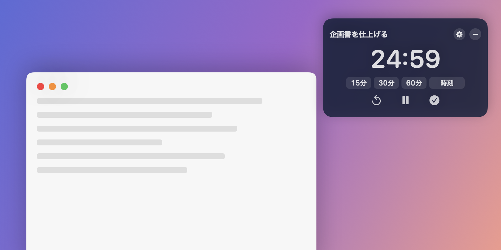
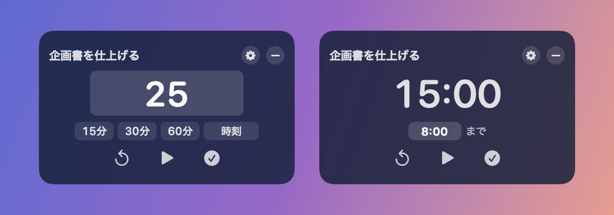
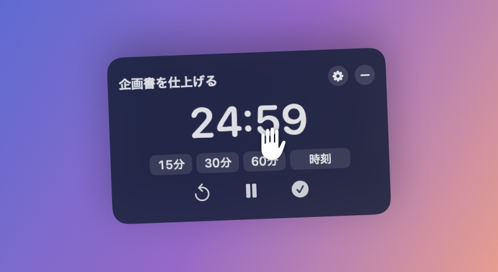
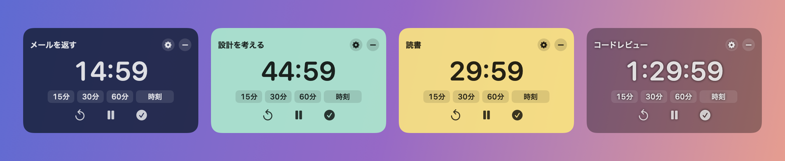
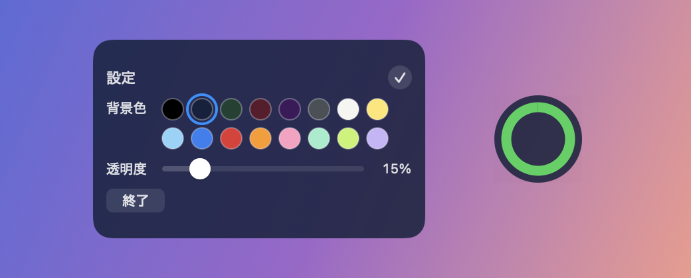

<div align="center">

# DesktopTimer

**画面の右上に浮かぶ、小さな作業タイマー**

全画面のアプリの上にも出続けるので、何をしていても残り時間が目に入る。


[](https://github.com/totsukash/desktop-timer/releases/latest)



</div>

## 入れ方

ターミナルに1行貼るだけ。

```sh
curl -fsSL https://raw.githubusercontent.com/totsukash/desktop-timer/main/install.sh | bash
```

- `~/Applications` に入り、すぐ起動する
- 次からはログインしたときに自動で起動する
- 更新するときも同じ1行

## 使い方

### 1. 時間を決めて始める



| やりたいこと | 操作 |
| --- | --- |
| 25分はかる | 大きな数字を押して `25` → Enter |
| 1分30秒はかる | `1:30` → Enter |
| 8時まではかる | 「時刻」を押して `8:00` → Enter |
| すぐ始める | 「15分」「30分」「60分」を押して ▶ |

上の「やることを入力」に、この時間でやることをメモできる。

### 2. どこを掴んでも運べる



文字やボタンの上からでも掴める。
持ち上げると少し縮み、振った向きに傾く。

### 3. 時間になったら


すべての画面が赤くなって知らせる。
「OK」か Enter で閉じる。

### 4. 早く終わったら


✓ の完了ボタンで、かかった時間を添えてお祝いする。

### 5. 色を変える・小さくたたむ





- 歯車のボタンで、背景色16色と透明度を選べる
- 「−」で小さな丸にたためる。丸の縁に進み具合が出て、押すと元に戻る

### 終了

背景を右クリックして「終了」。

## 消し方

```sh
launchctl unload ~/Library/LaunchAgents/com.totsukash.desktop-timer.plist 2>/dev/null
rm -f ~/Library/LaunchAgents/com.totsukash.desktop-timer.plist
pkill -x DesktopTimer
rm -rf ~/Applications/DesktopTimer.app
```

<details>
<summary><b>開発者向け</b></summary>

### ソースからビルドして入れる

Xcode か Command Line Tools が要る。

```sh
git clone https://github.com/totsukash/desktop-timer.git
cd desktop-timer
./install.sh
```

リポジトリの中で `./install.sh` を実行すると、手元でビルドしたものを入れる。

### 配布版を出す

```sh
./release.sh v1.0.1
```

Apple シリコンと Intel の両方で動く版を作り、GitHub のリリースに上げる。

### README の画像を撮り直す

```sh
swift build -c release
DESKTOP_TIMER_SNAPSHOT=docs/images .build/release/DesktopTimer
defaults delete DesktopTimer
```

</details>
